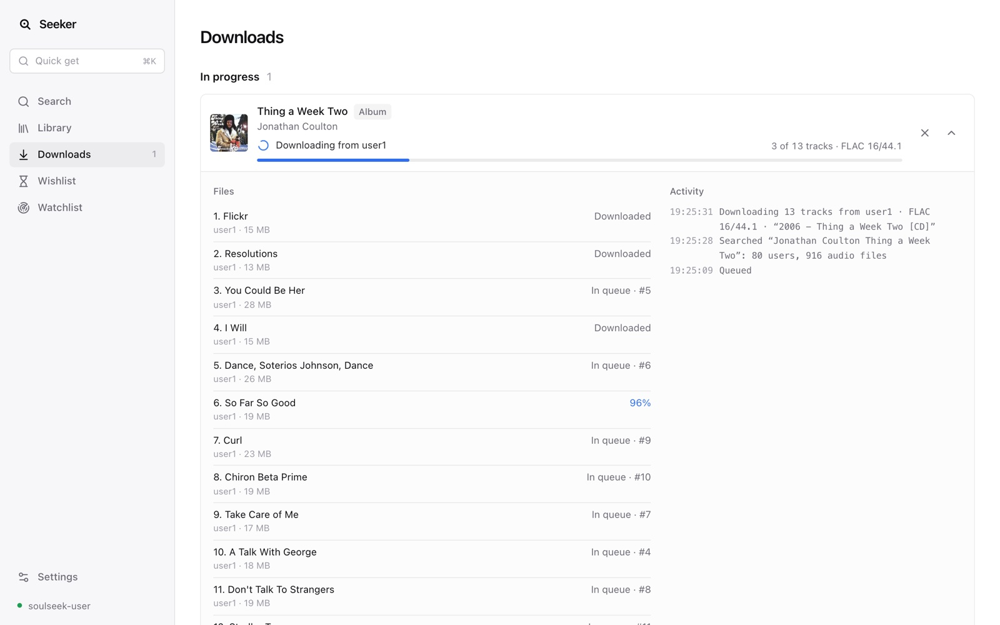
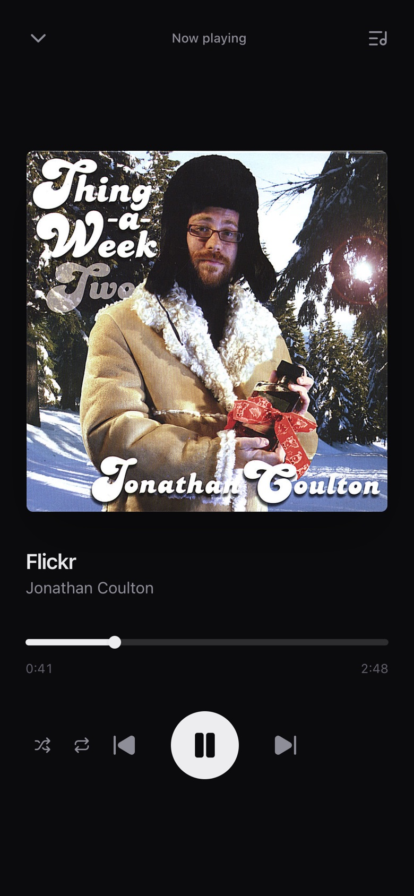

# Seeker

Seeker is a self-hosted music downloader for Soulseek. Type an album or a song and it finds the best copy on the
network through [slskd](https://github.com/slskd/slskd), checks the files, tags them and files them in your music
library, ready for Jellyfin or any other player. An AI assistant can do all of this too, over MCP.

> [!IMPORTANT]
> Seeker needs [slskd](https://github.com/slskd/slskd), the Soulseek client it downloads through, and doesn't include
> it. Set up slskd first by following [its quick start](https://github.com/slskd/slskd#quick-start).


## Contents

- [Features](#features)
- [Screenshots](#screenshots)
- [Install](#install)
  - [Set up slskd](#set-up-slskd)
  - [Run Seeker](#run-seeker)
- [Configuration](#configuration)
- [How a download works](#how-a-download-works)
- [Using Seeker](#using-seeker)
- [MCP](#mcp)
- [Updates](#updates)
- [Back up and restore](#back-up-and-restore)
- [Troubleshooting](#troubleshooting)
- [Development](#development)
  - [Releases](#releases)
- [Licence](#licence)

## Features

- **Search and download.** Type `Artist - Album` and press Enter to see the best match, then Enter again to get it.
  Press ⌘K (Ctrl K) on any page for the same thing, or browse artists, albums and songs.
- **Good copies.** Complete album folders from one user, in your preferred format (FLAC, then MP3 320 by default),
  from users with free slots first. If a user stalls or a file fails, Seeker switches to another copy, and keeps the
  album in one quality.
- **Checked files.** Every file must be the right length and play all the way through, and FLACs made from MP3s are
  thrown away. AcoustID fingerprinting is optional.
- **Tagged and filed.** Fresh tags with titles, track numbers, cover art and MusicBrainz IDs, saved as
  `Artist/Album (Year)/01 - Title.flac`.
- **More than one catalog.** Albums are found through Deezer, and through MusicBrainz when Deezer doesn't have them.
- **Wishlist and watchlist.** Things that can't be found yet are retried automatically, and new releases from artists
  you follow download by themselves.
- **Library and player.** Play your music in the browser with shuffle and repeat, and preview songs you don't own.
  Find a better copy of an album, fix badly tagged albums, or delete them.
- **Import.** Add music you already have: Seeker matches each folder to an album, tags it and files it.
- **Shares back.** When slskd shares your music folder, new music is shared on Soulseek automatically.
- **MCP server.** Everything in the app can be done and read by an AI assistant.

## Screenshots

An album downloading. Progress shows on the album page while Seeker works:


Every download lists its files, each file's place in the user's queue, and what Seeker did:



Your library, with the player:


On a phone, in dark mode:

<p>
  
  
</p>

The screenshots show freely licensed albums by Jonathan Coulton and Nine Inch Nails (Creative Commons).

## Install

Seeker is a Docker image, published on
[GitHub Packages](https://github.com/megaconfidence/seeker/pkgs/container/seeker) for 64-bit x86 and ARM. Run it
however you like: with `docker run`, Compose, Kubernetes or your NAS's container app. All it needs is a running slskd,
a few environment variables and four folders.

### Set up slskd

Seeker doesn't connect to Soulseek itself; it works through slskd. Install slskd by following
[its quick start](https://github.com/slskd/slskd#quick-start) and make sure it's connected to Soulseek. Seeker then
needs:

- **An slskd API key that can make changes.** slskd's primary key, set with `SLSKD_API_KEY`, works as it is. Keys
  added in `slskd.yml` need `role: readwrite`, because they're read-only by default. See
  [API keys](https://github.com/slskd/slskd/blob/master/docs/config.md#api-keys) in slskd's docs.
- **slskd's download folder.** Seeker picks finished downloads up there, so mount the same folder into Seeker.
- **To reach slskd's web port** (5030 by default) over the network.
- **Optionally, your music folder in slskd's shares**, so new music is shared back on Soulseek. See
  [shares](https://github.com/slskd/slskd/blob/master/docs/config.md#shares) in slskd's docs.

### Run Seeker

Pull the image:

```bash
docker pull ghcr.io/megaconfidence/seeker:latest
```

Then start it with your slskd's address and API key, and your folders.

**With Docker Compose.** Download the [compose file](docker-compose.yml) into a folder for Seeker:

```bash
mkdir seeker && cd seeker
curl -fsSLO https://raw.githubusercontent.com/megaconfidence/seeker/main/docker-compose.yml
```

Fill in the values it marks, then start Seeker:

```bash
docker compose up -d
```

**With `docker run`:**

```bash
docker run -d --name seeker --restart unless-stopped \
  -e PUID=1000 -e PGID=1000 \
  -p 7335:7335 \
  -e SEEKER_PASSWORD=choose-a-password \
  -e SLSKD_URL=http://192.168.1.10:5030 \
  -e SLSKD_API_KEY=your-slskd-api-key \
  -v /path/to/seeker-data:/data \
  -v /path/to/slskd/downloads:/downloads \
  -v /path/to/music:/music \
  -v /path/to/import:/import \
  ghcr.io/megaconfidence/seeker:latest
```

Either way, set `PUID` and `PGID` to the user and group slskd runs as, so Seeker can move finished downloads out of
slskd's folder, and make sure that user can write to your music, downloads and import folders. Seeker gives its own
data folder to that user when it starts. Then open `http://<your-server>:7335` and sign in with `SEEKER_PASSWORD`.
Every setting is listed under [Configuration](#configuration), for whichever way you run it.

**Rootless Docker.** Users in the container are other users on the host: user 1000 is a "subordinate" id such as
100999 (see `/etc/subuid`). `PUID=0` and `PGID=0` run Seeker as you, so the files it creates are yours on the host. If
you run Seeker with `--user` or `user:` instead, it can't change who owns its data folder; when it can't write there,
it stops and says which `chown` fixes it.

The default `PUID=1000`/`PGID=1000` gives a bind-mounted data folder to subordinate host ids such as `100999:100999`.
You can usually read the backups but need `sudo` to delete or restore files on the host. Use `PUID=0`/`PGID=0` if you
want to manage that folder as yourself, and make sure that identity can also access the music and downloads.

## Configuration

Environment variables:

| Variable | What it's for | Default |
| --- | --- | --- |
| `SEEKER_PASSWORD` | Password for the web app. Without one, Seeker makes one up and prints it in its log | |
| `SLSKD_URL` | slskd's address, as Seeker reaches it | `http://slskd:5030` |
| `SLSKD_API_KEY` | slskd API key that can make changes | |
| `ACOUSTID_API_KEY` | Optional: fingerprint every download | |
| `SEEKER_SCAN_CONCURRENCY` | Optional: how many files a library scan reads at once, from 1 to 64 | 4 on a network share, 12 otherwise |
| `PUID`, `PGID` | User and group Seeker runs as; the same as slskd's | `1000` |
| `UMASK` | Permissions for new files and folders; `002` makes them writable for the group | `022` |
| `TZ` | Time zone | `UTC` |

Folders, which Seeker must be able to write to:

| Path in the container | What it holds |
| --- | --- |
| `/data` | Seeker's database (settings, MCP tokens, downloads and watchlist) and its daily backups |
| `/downloads` | slskd's download folder, where Seeker picks finished downloads up |
| `/music` | Your library, where Seeker files new music |
| `/import` | Optional: music you already have, to add to your library |

The web app and the MCP server listen on port 7335. The container starts as root only to give `/data` to `PUID:PGID`,
then runs Seeker as that user. With `--user` or `user:`, it runs as that user from the start and leaves `/data` alone.
At startup, Seeker checks that it can write to each folder, and **Settings → Library** shows any it can't.

Everything else is in **Settings** in the app:

| Setting | What it does | Default |
| --- | --- | --- |
| Quality | Formats to accept, in order of preference; minimum MP3 bitrate; hi-res FLAC | FLAC, then MP3 320 |
| File names | Folder and file name template | `{albumartist}/{album} ({year})/{disctrack} - {title}` |
| Download checks | Length, decoding, fake lossless, AcoustID | All on; AcoustID needs a key |
| Jellyfin | Server address and API key, so Jellyfin rescans after new music arrives | Off |
| Watchlist | How often to check followed artists, and which release types count | Every 12 hours; albums and EPs |
| Wishlist | Keep retrying downloads that can't be found yet | On |
| Sharing | Ask slskd to rescan its shares once new music has stopped arriving and nothing is downloading | On, after 30 minutes |

The share quiet period is between 1 minute and 24 hours; saved values outside that are brought within it. Use
**Rescan shares automatically** to disable automatic scans. Initial indexing normally avoids a rescan of music slskd
already shares. **Rescan after first library scan** opts into it; if slskd shares nothing, Seeker still schedules a
rescan after initial indexing. If slskd later stops sharing anything while your library has music (after losing its
share cache, say), Seeker asks for one rescan. A rescan that's still to come when Seeker restarts (for an update, say)
is planned again when it starts.

## How a download works

1. Seeker looks the album or song up in the catalog to get the exact tracklist.
2. It searches Soulseek through slskd and scores every user's folder: how many tracks it has, the format, and how busy
   the user is.
3. It downloads the best folder. If a user stalls or a file fails, it moves to the next best copy.
4. Each file is checked, tagged with details from the catalog and MusicBrainz, and moved into your library.
5. Jellyfin rescans its library if you set it up. Once no new music has arrived for a while and nothing is
   downloading, Seeker asks slskd to rescan its shares, once for the whole batch.

If nothing is found, the download waits in the wishlist and is retried after 1 hour, then 4, 12 and 24 hours, then
every 3 days.

## Using Seeker

**Searching.** The search page finds artists, albums and songs. Press Enter to preview the best match before
downloading it, or use **Soulseek files** to pick an exact copy yourself. If an album isn't in the catalog, search
MusicBrainz from the bottom of the results.

**Library.** Open an album in your library to play it. The **⋯** menu can find a better-quality copy, match the album
to the catalog (fixing its tags, file names and cover), or delete it. Seeker rescans the music folder at startup and
every 6 hours, and when you press **Rescan**. If the folder is missing, unreadable or empty, or more than half the
library seems gone (at least 100 tracks), it leaves the library as it is and explains why at the top of the Library page: a network share
that isn't mounted looks just like that. If you did remove the music, press **Remove missing tracks**.

An entirely empty music folder is guarded even for small libraries. Unreadable files and folders keep their indexed
tracks; a forced rescan never treats those access failures as deletions.

Scans read only new and changed files, several at a time, and only their tags: a 5,000-track library on a network
share takes seconds to a few minutes the first time. The Library page shows how far a scan has got and the file it's
on, and albums appear as the scan saves them, every 200 tracks or 15 seconds. **Stop** ends a scan early: Seeker keeps
what it read, and the next scan (at startup, every 6 hours, or when you press **Rescan**) continues from there, as it
does after a restart. Folders NAS systems keep next to your music (`@eaDir`, `#recycle`, `#snapshot` and the like) are
skipped. Cover art embedded in the files isn't read during a scan; Seeker looks for it the first time an album without
a cover image in its folder is shown. Music that finishes downloading during a scan is added straight away.

On a network share (NFS, SMB, or a FUSE mount such as sshfs or rclone), Seeker reads 4 files at a time instead of 12,
so a scan doesn't crowd out everything else using the share; `SEEKER_SCAN_CONCURRENCY` sets the number yourself. A
file that doesn't answer within a minute is skipped until the next scan. If file after file doesn't answer, Seeker
stops the scan, says so on the Library page, and tries again in 10 minutes.

**Deletes are permanent.** Seeker has no recycle bin or undo for music files. Deleting a track or album removes its
audio files, and upgrades permanently replace lower-quality copies after better files are filed. Back up your music
before deleting or upgrading; the daily database backup does not contain audio.

**Importing.** Put album folders in the import folder (`/import`) and open **Library → Import music**. For each folder,
Seeker suggests matching albums and shows how many files fit. Choose one to tag the files and file them in your
library, either copying them or moving them. Folders that don't match anything can be imported with their own tags.

**Watchlist.** Open an artist and choose **Follow new releases**.

**Jellyfin.** Mount the same music folder in Jellyfin, then add Jellyfin's address and an API key (Dashboard → API keys)
under **Settings → Jellyfin**. Jellyfin rescans a minute after new music arrives.

**AcoustID.** Fingerprint checks need an *application* key from
[acoustid.org/new-application](https://acoustid.org/new-application); your user key won't work. Set it as
`ACOUSTID_API_KEY` or in **Settings**, then press **Test** under **Download checks**.

## MCP

Everything in the app can also be done over MCP, so an AI assistant can run Seeker for you. Create a token in
**Settings → MCP**, then add Seeker to your assistant. For Claude Code:

```bash
claude mcp add --transport http seeker http://your-server:7335/mcp --header "Authorization: Bearer <token>"
```

Settings also shows the JSON configuration for other clients. Then ask in plain language: "get me the new Fontaines
D.C. album", "what's stuck in my wishlist?", "find FLAC copies of the albums I only have as MP3".

| Area | Tools |
| --- | --- |
| Finding music | `search_music`, `find_match`, `search_musicbrainz`, `get_artist`, `get_album` |
| Downloading | `download`, `download_album`, `download_track`, `search_soulseek`, `download_files` |
| Downloads and wishlist | `list_downloads`, `get_download`, `wait_for_download`, `cancel_download`, `retry_download`, `retry_wishlist`, `remove_download`, `clear_finished_downloads` |
| Library | `list_library`, `search_library`, `get_library_album`, `upgrade_library_album`, `get_match_candidates`, `match_library_album`, `delete_library_album`, `delete_library_track`, `rescan_library`, `cancel_library_scan` |
| Importing | `list_import_folders`, `get_match_candidates`, `import_folder` |
| Watchlist | `list_watchlist`, `watch_artist`, `unwatch_artist`, `check_new_releases` |
| Settings and status | `get_status`, `get_settings`, `update_settings`, `test_jellyfin`, `test_acoustid`, `reconnect_soulseek`, `rescan_shares` |
| Access | `list_tokens`, `create_token`, `revoke_token` |

The assistant can read the app's state as well as change it:

- `get_status`: the Soulseek connection, sharing, download counts, library size and how far a library scan has got,
  the search budget, and the latest warnings and errors.
- `list_downloads` and `get_download`: each download's percent, speed, time left, queue position, missing tracks and
  log.
- `wait_for_download`: follows a download until it finishes.

Tools that delete things are marked, so assistants ask before using them. API keys are never shown, only whether
they're set.

## Updates

Every change to the app on `main` is published as a new image once the tests pass. `latest` follows `main`, and every
build is also tagged `sha-<commit>`, if you'd rather stay on one.

To update with Compose, run this in Seeker's folder:

```bash
docker compose pull
docker compose up -d
```

With `docker run`, pull the image, remove the container (`docker rm -f seeker`) and run the same command again.

**Settings → Account** shows the build you're running (`build 1a2b3c4`, the commit's short id), and so does
`get_status` over MCP.

## Back up and restore

Every day, Seeker copies its database to `backups` in its data folder and keeps the last 7. Back up that folder and
your music. To restore, stop Seeker, copy a backup over `seeker.db` in the data folder, delete `seeker.db-wal` and
`seeker.db-shm` next to it, and start Seeker again:

```bash
cp /path/to/seeker-data/backups/seeker-2026-11-12.db /path/to/seeker-data/seeker.db
rm -f /path/to/seeker-data/seeker.db-wal /path/to/seeker-data/seeker.db-shm
```

With rootless Docker and `PUID=1000`, the data folder belongs to a subordinate host id, so prefix both commands with
`sudo`. The entrypoint restores `PUID:PGID` ownership when Seeker starts again. With `PUID=0`/`PGID=0`, the folder
belongs to the user running rootless Docker and no `sudo` is needed. Changing to those ids also changes which music
and download files Seeker can access; check their permissions before switching.

## Troubleshooting

- **Seeker can't reach slskd**: `SLSKD_URL` must be an address Seeker can reach. Inside a container, `localhost` is
  the container itself, so use the server's address, or slskd's name when both are on the same Docker network. Check
  that `SLSKD_API_KEY` is a key slskd accepts.
- **"Not logged in to Soulseek"**: your account is probably signed in on another app; Soulseek allows one session per
  account. Close the other app, then press **Reconnect** in **Settings**.
- **Downloads never start, or users refuse them**: share some music in slskd, and forward its listening port (50300
  by default) on your router. See
  [listen port](https://github.com/slskd/slskd/blob/master/docs/config.md#listen-ip-address-and-port) in slskd's docs.
- **Seeker stops at startup with "Seeker can't use its data folder"**: the user it runs as can't write to `/data`.
  The message gives that user's ids, as the host sees them, and the fix. Usually you remove `--user` or `user:` and
  set `PUID` and `PGID`, so Seeker can fix the folder itself. On rootless Docker, the ids on the host are subordinate
  ids, so a folder you own isn't writable for container user 1000 (see [Rootless Docker](#run-seeker)).
- **Permission errors in a download's log**: Seeker must be able to move files out of slskd's download folder and into
  your library. Run it as the same user as slskd, and make sure that user can write to your music folder. Folders that
  Docker created for you belong to root. If Seeker isn't allowed to change a downloaded file but can change its folder,
  it tags a copy instead; if it can't change either, it files nothing and says so.
- **slskd stops responding for minutes after downloads**: rescanning a big library's shares, especially on a network
  share, keeps slskd busy. Make Seeker wait longer before it asks, or turn off **Rescan shares automatically** in
  **Settings → Soulseek** and let slskd rescan on a schedule with `SLSKD_SHARE_CACHE_RETENTION` (in minutes; see
  [share cache](https://github.com/slskd/slskd/blob/master/docs/config.md#cache) in slskd's docs). New music is then shared
  after slskd's next rescan, or when you press **Rescan**. Downloads that start while slskd is busy wait for it.
- **A download says "Waiting for the music folder" or "Waiting for free space"**: the music folder is missing, empty,
  read-only or temporarily unavailable, or a disk Seeker writes to is full or over its quota (the music folder, the
  downloads folder, or Seeker's data folder, where it makes temporary copies). Seeker keeps the downloaded files and
  any tracks already filed, then retries every 10 minutes. Fix the mount or permissions, or free some space, and press
  **Try again** in Downloads to resume immediately, without downloading again. Cancelling the job explicitly removes
  its downloaded files. "Waiting to try again" works the same way when filing failed for another reason; the
  download's details say why.
- **The library stopped updating**: Seeker can't see your music, usually because a network share isn't mounted, so
  it keeps the index. It looks again every 10 minutes, or press **Rescan** on the Library page.
- **A library scan makes the server or the share slow**: set `SEEKER_SCAN_CONCURRENCY` to read fewer files at once
  (`2`, say), or more for a fast NAS. Press **Stop** on the Library page to stop a scan for now; the next one continues
  where it left off.
- **AcoustID says the key is invalid**: use an application key, not your user key.
- **Something else**: **Settings** shows the Soulseek connection and sharing, and every download's details include a
  step-by-step log. Over MCP, `get_status` lists recent warnings and errors.

## Development

The server is TypeScript run directly by Node 24 (no build step), with Hono and SQLite. The web app is React, Vite and
Tailwind CSS. Trying real downloads needs a running slskd; the tests don't.

```bash
cd seeker
npm install
cp dev.env.example dev.env   # add your slskd's address and API key
npm run dev                  # server on :7335
npm run dev:web              # web app with hot reload on :5173
npm test                     # needs ffmpeg; runs offline against a fake slskd and catalog
npm run typecheck
docker build -t seeker .     # build the image yourself
```

```text
docker-compose.yml     Example compose file for running Seeker
seeker/server/         API, download engine, MCP server
seeker/web/            Web app
seeker/shared/         Types shared by the server and the web app
seeker/test/           Tests and fakes
seeker/Dockerfile      The image
```

[AGENTS.md](AGENTS.md) explains the code in more detail for coding agents.

### Releases

`.github/workflows/docker.yml` checks the types and runs the tests on every push to `main` and every pull request.
Only if they pass does it build the image, for x86 and ARM. Pushes to `main` publish it as `latest` and
`sha-<commit>`, and a version tag such as `v0.2.0` publishes `0.2.0` and `0.2`. Pull requests are built but never
published, and changes that only touch documentation (Markdown files and `docs/`) or the example compose file skip the
workflow. A fork publishes to `ghcr.io/<its-owner>/seeker`.

---

## Licence

Seeker is available under the [MIT licence](LICENSE). Third-party dependencies keep their own licences.

Only download music you have the right to.
