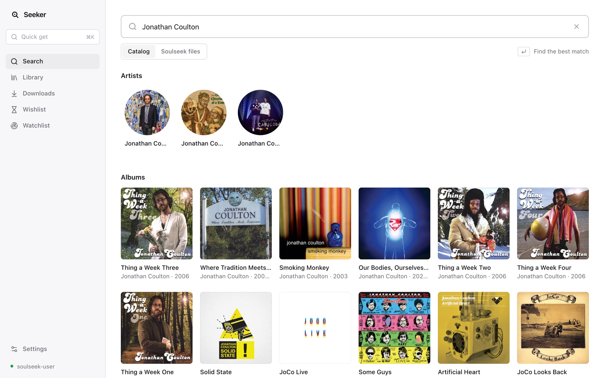
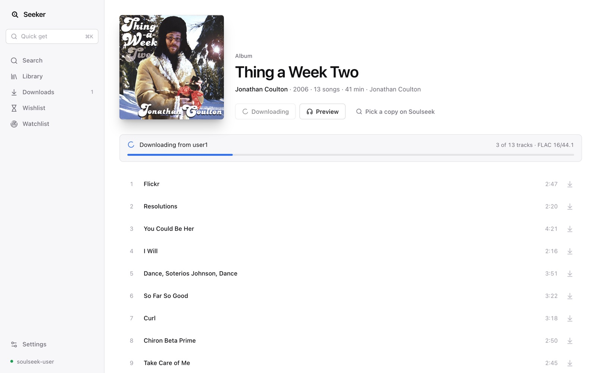
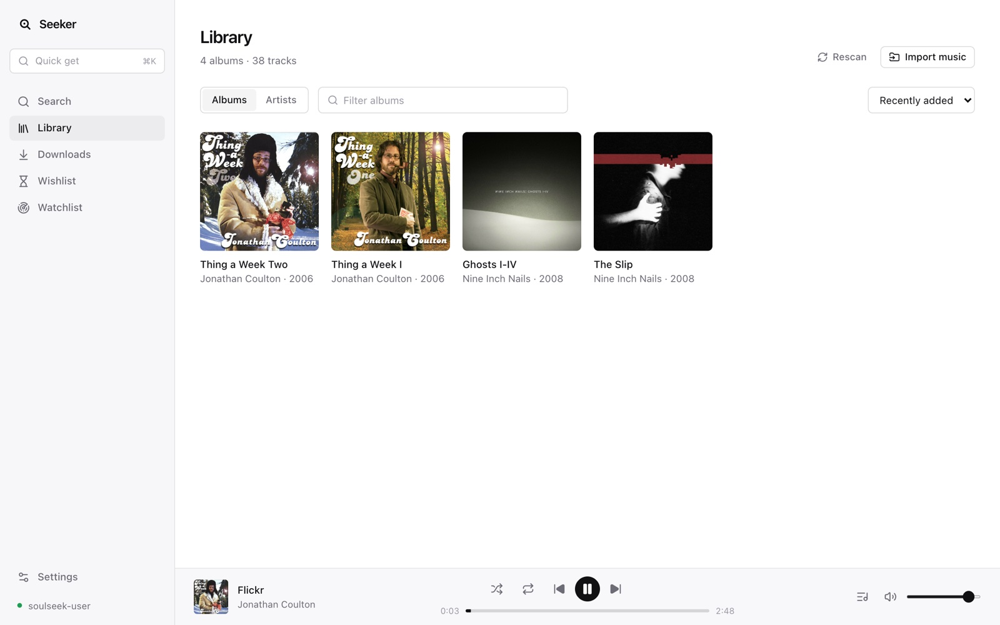
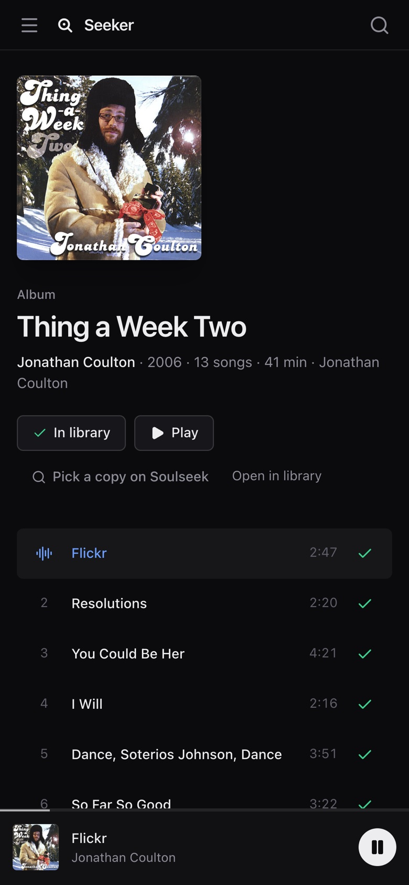

# Seeker

Seeker is a self-hosted music downloader for Soulseek. Type an album or a song and it finds the best copy on the
network through [slskd](https://github.com/slskd/slskd), checks the files, tags them and files them in your music
library, ready for Jellyfin or any other player. An AI assistant can do all of this too, over MCP.



## Features

- **Search and download.** Type `Artist - Album` and press Enter to see the best match, then Enter again to get it.
  Press ⌘K (Ctrl K) on any page for the same thing, or browse artists, albums and songs.
- **Good copies.** Complete album folders from one user, in your preferred format (FLAC, then MP3 320 by default),
  from users with free slots first. If a user stalls or a file fails, Seeker switches to another copy, and keeps the
  album in one quality.
- **Checked files.** Every file must be the right length and play all the way through, and FLACs made from MP3s are
  thrown away. AcoustID fingerprinting is optional.
- **Tagged and filed.** Fresh tags with titles, track numbers, cover art and MusicBrainz IDs, saved as
  `Artist/Album (Year)/01 - Title.flac`.
- **More than one catalog.** Albums are found through Deezer, and through MusicBrainz when Deezer doesn't have them.
- **Wishlist and watchlist.** Things that can't be found yet are retried automatically, and new releases from artists
  you follow download by themselves.
- **Library and player.** Play your music in the browser with shuffle and repeat, and preview songs you don't own.
  Find a better copy of an album, fix badly tagged albums, or delete them.
- **Import.** Add music you already have: Seeker matches each folder to an album, tags it and files it.
- **Shares back.** New music is shared on Soulseek automatically.
- **MCP server.** Everything in the app can be done and read by an AI assistant.

## Screenshots

An album downloading. Progress shows on the album page while Seeker works:



Every download lists its files, each file's place in the user's queue, and what Seeker did:


Your library, with the player:



On a phone, in dark mode:

<p>
  
  
</p>

The screenshots show freely licensed albums by Jonathan Coulton and Nine Inch Nails (Creative Commons).

## Getting started

You need Docker with Compose, and a Soulseek account. Any unused username and password creates an account the first
time slskd logs in.

1. Get the code and create your settings file:

   ```bash
   git clone https://github.com/megaconfidence/seeker.git
   cd seeker
   cp .env.example .env
   ```

2. Fill in `.env`. At least: `SLSK_USERNAME`, `SLSK_PASSWORD`, `SEEKER_PASSWORD` and `SLSKD_API_KEY`
   (make one with `openssl rand -hex 24`). Point `MUSIC_DIR` at your library.
3. Start Seeker and slskd:

   ```bash
   docker compose up -d --build
   ```

4. Open http://localhost:7335 and sign in with `SEEKER_PASSWORD`.

slskd's own interface is at http://localhost:5030. For better connections, forward TCP port 50300 on your router to
this machine.

Please share: everything in your music folder is shared on Soulseek (read-only), and users who share nothing are often
refused.

## Configuration

These go in `.env`:

| Variable | What it's for | Default |
| --- | --- | --- |
| `SLSK_USERNAME`, `SLSK_PASSWORD` | Your Soulseek account | |
| `SEEKER_PASSWORD` | Password for Seeker's web app | |
| `SLSKD_API_KEY` | Key Seeker uses to talk to slskd, 16 characters or more | |
| `SLSKD_WEB_USERNAME`, `SLSKD_WEB_PASSWORD` | Login for slskd's own interface | `admin`, `change-me` |
| `MUSIC_DIR` | Your library | `./music` |
| `DOWNLOADS_DIR` | Where slskd downloads to; Seeker picks files up from here | `./downloads` |
| `IMPORT_DIR` | Music you want to add to your library | `./import` |
| `ACOUSTID_API_KEY` | Optional: fingerprint every download | |
| `PUID`, `PGID` | User and group that own the files | `1000` |
| `TZ` | Time zone | `UTC` |

Everything else is in **Settings** in the app:

| Setting | What it does | Default |
| --- | --- | --- |
| Quality | Formats to accept, in order of preference; minimum MP3 bitrate; hi-res FLAC | FLAC, then MP3 320 |
| File names | Folder and file name template | `{albumartist}/{album} ({year})/{disctrack} - {title}` |
| Download checks | Length, decoding, fake lossless, AcoustID | All on; AcoustID needs a key |
| Jellyfin | Server address and API key, so Jellyfin rescans after new music arrives | Off |
| Watchlist | How often to check followed artists, and which release types count | Every 12 hours; albums and EPs |
| Wishlist | Keep retrying downloads that can't be found yet | On |

## How a download works

1. Seeker looks the album or song up in the catalog to get the exact tracklist.
2. It searches Soulseek through slskd and scores every user's folder: how many tracks it has, the format, and how busy
   the user is.
3. It downloads the best folder. If a user stalls or a file fails, it moves to the next best copy.
4. Each file is checked, tagged with details from the catalog and MusicBrainz, and moved into your library.
5. slskd rescans your shares, and Jellyfin rescans its library if you set it up.

If nothing is found, the download waits in the wishlist and is retried after 1 hour, then 4, 12 and 24 hours, then
every 3 days.

## Using Seeker

**Searching.** The search page finds artists, albums and songs. Press Enter to preview the best match before
downloading it, or use **Soulseek files** to pick an exact copy yourself. If an album isn't in the catalog, search
MusicBrainz from the bottom of the results.

**Library.** Open an album in your library to play it. The **⋯** menu can find a better-quality copy, match the album
to the catalog (fixing its tags, file names and cover), or delete it.

**Importing.** Put album folders in `IMPORT_DIR` and open **Library → Import music**. For each folder, Seeker suggests
matching albums and shows how many files fit. Choose one to tag the files and file them in your library, either
copying them or moving them. Folders that don't match anything can be imported with their own tags.

**Watchlist.** Open an artist and choose **Follow new releases**.

**Jellyfin.** Mount the same music folder in Jellyfin, then add Jellyfin's address and an API key (Dashboard → API keys)
under **Settings → Jellyfin**. Jellyfin rescans a minute after new music arrives.

**AcoustID.** Fingerprint checks need an *application* key from
[acoustid.org/new-application](https://acoustid.org/new-application); your user key won't work. Put it in `.env` as
`ACOUSTID_API_KEY` or in **Settings**, then press **Test** under **Download checks**.

## MCP

Everything in the app can also be done over MCP, so an AI assistant can run Seeker for you. Create a token in
**Settings → MCP**, then add Seeker to your assistant. For Claude Code:

```bash
claude mcp add --transport http seeker http://your-server:7335/mcp --header "Authorization: Bearer <token>"
```

Settings also shows the JSON configuration for other clients. Then ask in plain language: "get me the new Fontaines
D.C. album", "what's stuck in my wishlist?", "find FLAC copies of the albums I only have as MP3".

| Area | Tools |
| --- | --- |
| Finding music | `search_music`, `find_match`, `search_musicbrainz`, `get_artist`, `get_album` |
| Downloading | `download`, `download_album`, `download_track`, `search_soulseek`, `download_files` |
| Downloads and wishlist | `list_downloads`, `get_download`, `wait_for_download`, `cancel_download`, `retry_download`, `retry_wishlist`, `remove_download`, `clear_finished_downloads` |
| Library | `list_library`, `search_library`, `get_library_album`, `upgrade_library_album`, `get_match_candidates`, `match_library_album`, `delete_library_album`, `delete_library_track`, `rescan_library` |
| Importing | `list_import_folders`, `get_match_candidates`, `import_folder` |
| Watchlist | `list_watchlist`, `watch_artist`, `unwatch_artist`, `check_new_releases` |
| Settings and status | `get_status`, `get_settings`, `update_settings`, `test_jellyfin`, `test_acoustid`, `reconnect_soulseek`, `rescan_shares` |
| Access | `list_tokens`, `create_token`, `revoke_token` |

The assistant can read the app's state as well as change it:

- `get_status`: the Soulseek connection, sharing, download counts, library size, the search budget, and the latest
  warnings and errors.
- `list_downloads` and `get_download`: each download's percent, speed, time left, queue position, missing tracks and
  log.
- `wait_for_download`: follows a download until it finishes.

Tools that delete things are marked, so assistants ask before using them. API keys are never shown, only whether
they're set.

## Run it on a home server

The `deploy` folder runs the published image, `ghcr.io/megaconfidence/seeker`, instead of building one, so the server
only needs Docker with Compose. The image is built for 64-bit x86 and ARM, so it runs on most NAS boxes and on a
Raspberry Pi with a 64-bit OS.

### How new versions are published

The workflow in `.github/workflows/docker.yml` runs on every push to `main`. It checks the types and runs the tests,
and only if they pass builds the image and publishes it:

- `latest` follows `main`
- `sha-<commit>` marks every build
- a version tag such as `v0.2.0` publishes `0.2.0` and `0.2`

Pull requests are tested and built, but nothing is published. A fork publishes to `ghcr.io/<its-owner>/seeker`; set
`SEEKER_IMAGE` to use it. New packages start out private, so make yours public under **Packages** → **seeker** →
**Package settings**.

### Set up the server

1. Get the `deploy` folder onto the server, and create `.env` in it:

   ```bash
   git clone https://github.com/megaconfidence/seeker.git
   cd seeker/deploy
   cp ../.env.example .env
   ```

2. Fill in `.env` as above (`SEEKER_IMAGE` already points at the published image). Set `PUID` and `PGID` to the user
   that should own your music (`id -u` and `id -g`). Paths are relative to the `deploy` folder.
3. Create the folders before the first start. Otherwise Docker creates them owned by root, and Seeker and slskd can't
   write to them:

   ```bash
   mkdir -p music downloads import seeker-data slskd
   sudo chown -R 1000:1000 music downloads import seeker-data slskd   # your PUID:PGID
   ```

4. Start everything with `docker compose up -d`. Seeker is at `http://<server>:7335`, slskd at `http://<server>:5030`.
5. Forward TCP port 50300 on your router to the server. Don't forward 5030 or 7335.

### Remote access and HTTPS

[Tailscale](https://tailscale.com) is the simplest private option. Install it on the server and your devices, and
open Seeker at the server's Tailscale name. `tailscale serve --bg 7335` on the server adds HTTPS.

To use your own domain, `docker-compose.https.yml` puts Caddy in front of Seeker with a free Let's Encrypt
certificate:

1. Point the domain at your home IP address, and forward ports 80 and 443 to the server.
2. Add `SEEKER_DOMAIN=music.example.com` and `COMPOSE_FILE=docker-compose.yml:docker-compose.https.yml` to `.env`.
3. Run `docker compose up -d`.

This needs Docker Compose 2.24.4 or newer. If you use another reverse proxy, set `SEEKER_TRUST_PROXY=true` for Seeker,
but only if Seeker can't be reached without going through the proxy.

### Updates

With [Watchtower](https://github.com/nicholas-fedor/watchtower) on the server, every push to `main` deploys itself:
the workflow publishes a new image, and Watchtower replaces the Seeker container at its next check. The deploy
compose file labels Seeker with `com.centurylinklabs.watchtower.enable=true`, so this also works when Watchtower only
updates containers that opt in. Watchtower checks once a day by default; set `WATCHTOWER_POLL_INTERVAL=300` on it to
check every 5 minutes. (The original `containrrr/watchtower` is no longer maintained; `nickfedor/watchtower` is a
drop-in replacement.)

**Settings → Account** shows the build you're running (`build 1a2b3c4`, the commit's short id), and so does
`get_status` over MCP. Without Watchtower, update by hand:

```bash
docker compose pull
docker compose up -d
```

### Back up and restore

Seeker copies its database (settings, tokens, downloads and watchlist) to `seeker-data/backups` every day and keeps the
last 7. Back up that folder, your music, and `.env`. To restore, stop Seeker, put a backup in place of
`seeker-data/seeker.db`, delete `seeker.db-wal` and `seeker.db-shm`, and start it again:

```bash
docker compose stop seeker
cp seeker-data/backups/seeker-2026-11-12.db seeker-data/seeker.db
rm -f seeker-data/seeker.db-wal seeker-data/seeker.db-shm
docker compose up -d
```

## Troubleshooting

- **"Not logged in to Soulseek"**: your account is probably signed in on another app; Soulseek allows one session per
  account. Close the other app, then press **Reconnect** in **Settings**.
- **Downloads never start, or users refuse them**: share some music, and forward port 50300 to slskd.
- **Permission errors on a Linux server**: the folders must belong to `PUID:PGID`; see step 3 of the server setup.
- **AcoustID says the key is invalid**: use an application key, not your user key.
- **Something else**: **Settings** shows the Soulseek connection and sharing, and every download's details include a
  step-by-step log. Over MCP, `get_status` lists recent warnings and errors.

## Development

The server is TypeScript run directly by Node 24 (no build step), with Hono and SQLite. The web app is React, Vite and
Tailwind CSS.

```bash
cd seeker
npm install
cp dev.env.example dev.env   # add the API key of a running slskd
npm run dev                  # server on :7335
npm run dev:web              # web app with hot reload on :5173
npm test                     # needs ffmpeg; runs offline against a fake slskd and catalog
npm run typecheck
```

```text
docker-compose.yml     Seeker and slskd, built locally
deploy/                Home server setup with the published image, and HTTPS
seeker/server/         API, download engine, MCP server
seeker/web/            Web app
seeker/shared/         Types shared by the server and the web app
seeker/test/           Tests and fakes
```

[AGENTS.md](AGENTS.md) explains the code in more detail for coding agents.

Only download music you have the right to.
